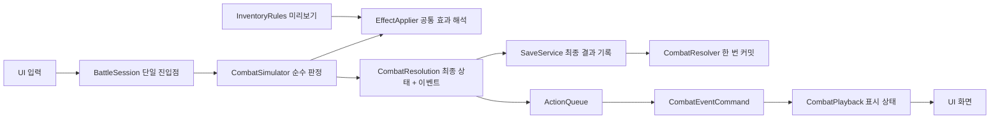

# 전투 판정과 재생

0.2.0에서 도입하고 0.11.0 데이터 기반 효과·보상·저장·경로·사건과 전투 피드백에서도 유지하는 구조. 스레드를 도입하지 않고, 메인 스레드의 입력·신호·Tween 콜백 사이에서 상태가 섞이는 문제를 제어한다.



## 책임

| 계층 | 책임 | 금지하는 의존 |
|---|---|---|
| `InventoryRules` / `GridRules` | 값 형태의 배치·회전·미리보기. 아이템 ID·태그 이름에 따른 분기 없음 | Node, 연출, 시간 |
| `EffectApplier` | 효과 단위의 조건·수치·중첩 해석과 피해/방어/회복 계산 | 콘텐츠 ID, IO, Resource, UI |
| `ItemData` / `EffectUnit` | 검증된 콘텐츠의 Resource 필드 | 함수·신호·Callable |
| `ContentLoader` / `ItemCodec` | CSV·JSON 검증 → Resource → 분리된 값 스냅샷 | 전투 실행·연출 |
| `CombatSimulator` | 복사한 상태에서 요청과 연쇄 효과를 끝까지 계산 | SceneTree, 신호, Tween, await, 외부 객체 변경 |
| `RouteRules` | 경로 단계·적 순서·보상 참조를 값으로 계산 | Node, IO, 시간, UI |
| `EventRules` | 유품 임시 선택·확정·건너뛰기·후속 확인의 순수 값 판정 | 콘텐츠 ID, IO, Resource, UI |
| `RewardRules` | 승리 제안·후보 선택·확정·건너뛰기의 순수 값 판정 | 콘텐츠 ID, IO, Resource, UI |
| `CombatResolution` | 이전·최종 상태, 이벤트 목록. 접근 시 깊은 복사 반환 | 실행 중인 게임 객체 |
| `CombatResolver` | 성공한 결과만 권위 상태와 인벤토리에 커밋 | UI 갱신 신호, 연출 |
| `SaveCodec` / `SaveService` | 값 검증·파일 교체·이전 정상본 관리 | UI 표시, 재판정 |
| `BattleSession` | 명령 진입점, 저장 성공 후 커밋, 재생 중 입력 잠금, 재시작·배치 트랜잭션 | 화면별 전투 판정 |
| `ActionQueue` | 한 번에 한 명령, 완료·취소·시간 초과 관리 | 전투 규칙 |
| `CombatEventCommand` | 한 이벤트의 Tween과 완료·취소 | 실제 체력·기력·인벤토리 수정 |
| `CombatPlayback` | 이벤트 순서에 따른 표시 상태, 건너뛰기·복구 | 판정 재실행 |
| UI | `display_snapshot()`으로 수치·보드·사용 표시를 함께 그림 | 권위 상태를 미리 읽어 표시 |

`CombatResolver`의 동기 헬퍼는 기존 헤드리스 규칙 테스트에 사용한다. 실제 게임의 전투·보상 요청은 `BattleSession.submit()`만 호출한다. 배치 변경은 `BattleSession`이 `InventoryModel` 복사본을 검증하고 저장한 뒤 적용한다. 보상과 사건 요청은 `CombatResolver`가 순수 `RewardRules`와 `EventRules`로 분기한다. 두 번째 승리에서의 후속 반응과 회복은 순수 판정 내 승리 이벤트 뒤에 원인 ID를 붙여 기록한다. 상세한 계약은 [보상 흐름](reward-flow.md)과 [저장 시스템](save-system.md)을 따른다.

읽기 전용 [턴 종료 미리보기](turn-preview.md)는 `BattleSession.preview_end_turn()`에서 표시 스냅샷을 같은 순수 판정기에 전달한다. 결과를 커밋하거나 저장하지 않으며 재생 중에는 이용하지 않는다. 전투 상태를 바꾸는 명령 진입점은 여전히 `submit()` 하나다.

[시너지 연결 표시](synergy-visualization.md)는 표시 스냅샷 또는 유효한 가상 배치에서 동일한 효과 계획의 원인·범위를 읽는다. 서로 닿는지, 스택이 적용됐는지를 UI에서 별도로 판정하지 않으며 전투 재생 도중에는 연결을 숨긴다.

## 한 행동의 처리

1. 세션이 요청 중·재생 중인지 검사한다. 잠겼으면 거절하고 기력·상태를 건드리지 않는다.
2. `ItemCodec`이 아이템과 효과 Resource를 순수 값 스냅샷으로 바꾸고 판정기에 전달한다.
3. 판정기는 복사본에서 비용, 인접 보너스, 타격, 반응 효과, 소모, 사망·승패를 계산한다.
4. 판정이 성공하면 최종 상태를 저장한다. 저장까지 성공했을 때만 최종 상태를 한 번 확정한다. 실패하면 현재 상태와 이력을 유지한다. 커밋 도중 인벤토리 `changed`를 발행하지 않는다.
5. 표시 상태는 행동 전 상태에서 시작한다. 큐의 각 명령이 타격 지점에 이르면 해당 이벤트의 `after` 스냅샷을 적용하고 피해 수치·메시지·체력바를 함께 표시한다. 그 뒤 남은 연출을 끝내고 다음 명령으로 이동한다.
6. 마지막 명령 이후 표시 상태를 최종 상태와 맞추고 다음 입력을 허용한다.

예를 들어 약과는 판정 시 이미 소모되지만, 화면의 보따리·선택 정보에서는 `consumed` 이벤트가 재생될 때 함께 사라진다. 화면이 최종 인벤토리와 이전 체력을 섞어 읽지 않는다.

## 연쇄 효과 규칙

- 파생 효과는 FIFO로 처리한다. 재귀 호출이나 노드 신호로 다음 효과를 실행하지 않는다.
- 동일 피해에 반응하는 효과는 `priority` 오름차순, 같은 우선순위는 출처 인스턴스 ID·효과 ID 순서다.
- `modify_power`는 해당 효과 실행의 수치에만 더한다. `stack_group`이 같으면 우선순위·출처 ID·효과 ID 순서에서 처음 조건을 만족한 하나를 적용한다. 빈 그룹은 각각 더한다. 기존 부적의 중복 방지 역시 데이터로 표현한다.
- `multiply_power`는 고정 증가 후 정수 배율을 결정적 순서로 곱한다. 같은 그룹의 중복 제거는 덧셈과 곱셈별로 독립된다. 계산 한도를 넘는 실제 효과는 판정 전체를 거절하며, 결과 이벤트에는 원인 ID가 이어진 `power_multiplier`가 포함된다. [계산과 데이터 계약](data-pipeline.md)
- 수정 대상과 수량 계수 범위는 데이터로 각각 상하좌우·대각선·합집합을 선택할 수 있다. 여러 접점은 같은 물건을 중복시키지 않는다. 기존 효과 값의 의미는 유지한다. [범위 데이터 계약](data-pipeline.md)
- 반응 효과는 **실제 체력 피해가 1 이상** 발생했을 때 작동한다. 전부 방어로 흡수한 공격에는 발동하지 않는다.
- 트리거의 기본 `max_per_action`은 1이며 카운터는 루트 요청마다 초기화한다.
- 한 요청의 처리 효과 수와 기록 이벤트 수는 각각 최대 128, 연쇄 깊이는 최대 32다. 초과하면 비용·피해·소모를 포함한 요청 전체를 거절한다. 일부 결과만 적용하지 않는다.
- 치명타를 받은 적의 가시는 해당 타격에 반응할 수 있다. 파생 효과가 끝난 뒤 승패를 판정하며, 양쪽 사망은 패배로 처리한다. 죽은 대상에게 후속 방어·회복을 주지 않는다.
- 소비는 연쇄 효과 뒤, 승패 판정 전에 확정한다. 턴 종료 시 연쇄가 끝난 뒤 살아 있으면 다음 턴의 방어 해제·기력 회복을 처리한다.

각 이벤트는 `id`, `cause_id`, `kind`, `source`/`target` 등 효과 정보, `message`, `after`를 가진다. ID는 해당 요청 안에서 순서대로 부여한다. 동일 값 입력은 동일 결과와 재생 순서를 만든다. 현재 난수는 없으며 저장은 최종 상태를 보관한다.

검증 시나리오의 예:

```text
1 action_started   칼 사용·기력 소모
2 adjacency_bonus  인접 봉인부 +2           cause=1
3 damage           적 체력 감소            cause=2
4 damage           가시 → 플레이어 반사 피해 cause=3
5 guard            반응 방패의 방어 획득     cause=4
```

새 트리거 데이터의 현재 형태는 다음과 같다. `on`은 현재 '소유자가 체력 피해를 받음'으로 고정되어 있으며, 새 트리거 시점을 추가할 때 판정기와 테스트를 확장한다. 범용 스크립트나 Callable을 데이터에 넣지 않는다.

```gdscript
{
    "id": "enemy_spikes", "name": "가시", "owner": "enemy",
    "effect": "damage", "target": "player", "amount": 3,
    "priority": 0, "max_per_action": 1,
}
{
    "id": "reactive_shield", "name": "반응 방패", "owner": "player",
    "effect": "guard", "target": "player", "amount": 5,
    "priority": 0, "max_per_action": 1,
}
```

위 `reactions` 배열은 기존 연쇄 검사용 전투 픽스처이며 다음 길목에서 비운다. 0.4.0의 실제 콘텐츠 반응은 `damage_taken` 효과 단위로 작성한다. 플레이어는 현재 보따리에 들어 있는 아이템만, 적은 현재 encounter의 `reaction_ids`만 조회한다. 소모품의 반응은 자신의 루트 행동이 끝나기 전까지 작동하며 소비 후 제거된다. 기존 출시 콘텐츠 12종·적 3종에 가시·방패 능력을 추가하지는 않았다. 장착·보관·소모·순환 반응은 별도 데이터 테스트로 검증한다.

연출별 피격 대상, 차단·회복 수치와 캔슬 처리는 [전투 피드백](combat-feedback.md)에 기록한다. 메시지는 `event_started`가 아니라 표시 스냅샷이 적용된 `event_presented`에서 갱신한다.

## 완료·취소·복구

`ActionQueue`는 `completed`를 먼저 연결한 뒤 `execute()`를 호출한다. 즉시 완료하는 명령도 신호를 놓치지 않는다. 다음 명령은 다음 프레임에 시작하므로 동기 완료가 길게 이어져도 재귀 스택이 늘어나지 않는다. 명령은 재사용할 수 없으며 중복 완료는 무시한다.

명령당 기본 4초 안에 완료되지 않으면 현재 Tween과 나머지 명령을 취소한다. 이미 커밋된 결과를 다시 계산하거나 되돌리지 않고 최종 표시 상태로 복구한다. `연출 건너뛰기`도 같은 원칙이다.

재시작·장면 종료는 현재 Tween을 `kill()`하고 대기 명령·완료 연결을 제거한다. 큐 세대 번호와 명령의 종료 플래그로 이전 콜백을 거절한다. 명령 시작 신호 안에서 재시작되는 재진입도 검사한다. 새 런에 이전 런의 최종 상태를 적용하지 않는다.

타임아웃은 완료 누락에 대한 보호다. 메인 스레드를 막는 무한 루프를 강제 중단하는 기능은 아니다. 따라서 `execute()`는 즉시 반환해야 하고 판정 루프에는 상한을 유지한다. 런타임 코드에는 await를 사용하지 않으며, 비동기 동작을 관찰하는 테스트에서만 프레임·타이머를 기다린다.

Tween은 명령마다 새로 생성하고 해당 명령이 취소 시 정리한다. [Godot Tween 문서](https://docs.godotengine.org/en/stable/classes/class_tween.html), [Signal 문서](https://docs.godotengine.org/en/stable/classes/class_signal.html)

## 수정 시 검증

`bash scripts/check.sh`는 의존 경계 검사, 기존 규칙, 연쇄 판정, 재생 큐, UI 통합 검사를 실행한다. 경계 검사는 후속 에이전트가 UI에 판정·await를 섞거나 재생기에서 권위 상태에 접근하는 실수를 잡는 보조 장치다. 의미적 정확성까지 자동으로 보장하지는 않는다.

새 효과는 적어도 정상 연쇄 순서·중복/순환·치명타·오류 시 전체 거절·미리보기 일치를 확인한다. 새 연출은 즉시 완료·완료 누락·취소 후 늦은 완료·건너뛰기·재시작·장면 종료에서 상태와 표시가 일치하는지 확인한다.

## 콘텐츠 변경

스키마·효과 조합·Google Sheets 작업 절차는 [데이터 파이프라인](data-pipeline.md)을 따른다. 여러 사용 효과는 비용을 한 번 지불한 뒤 정렬된 순서로 FIFO에 넣는다. 각 효과에서 파생된 반응은 이미 대기 중인 효과의 뒤에 붙는다. 장비 반응 카운터는 인스턴스 ID와 효과 ID로 구분한다. 판정기는 파일을 읽지 않으며 초기 체력·기력·적 의도도 입력 스냅샷의 `config`에서 받는다.


## 사건 기반 결말 명령

콘텐츠의 선택적 `resolutions` 표는 사건과 결말 문구를 참조하며 `ContentLoader`가 검증한다. `resolve_encounter`는 `BattleSession.submit()`에서 시작해 해당 사건의 물건이 보따리에 있는지 순수 판정하고 결과 이벤트를 반환한다. 저장 성공 후 커밋하며 재생은 이벤트의 표시 스냅샷만 사용한다. 증거 부재·중복 요청·저장 실패는 거절한다. 결말과 조기 완료는 저장 버전 4에서 검증·복구한다. 본편 아랑 카탈로그는 결말 표를 사용한다. [아랑전설 1스테이지](arang-stage-one.md)
