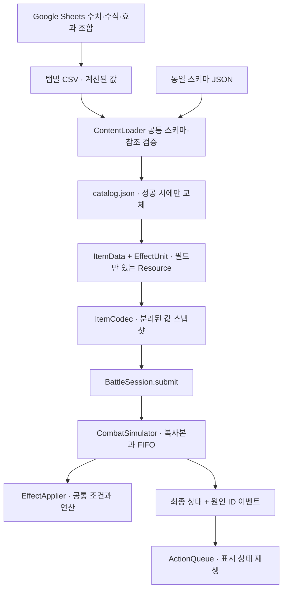

# 콘텐츠 데이터와 실행 엔진

0.4.0부터 아이템 ID·이름·특정 태그를 아는 런타임 분기를 제거했다. 기존 12개 아이템, 적 3종, 초기 수치·배치를 데이터로 이관했다. 수백 개 정의를 등록하는 것과 실제 런에 지급하는 물건 수는 별개다.



## 기획 작업 순서

1. `outputs/data-driven-content/balance-template.xlsx`를 Google Sheets로 가져온다. 이 파일은 로컬에서 수식·값·렌더링을 검증한 가져오기용 템플릿이다. Google 계정에 업로드하거나 원격 문서를 생성하지는 않았다.
2. `effects`의 `_base_amount`와 `Balance`의 연산별 배율을 조정한다. `amount`는 반올림한 정수 수식 결과다. 배율은 아군과 적의 해당 연산 모두에 적용되며, `modify_power`는 `affects` 연산의 배율을 따른다. 필요하면 기획에 맞는 수식으로 교체해도 된다.
3. 아이템의 비용·횟수·형태·태그·효과 참조는 `items`에서 편집한다. 복합 효과는 `effect_ids`에 `a_hit|b_guard|c_heal`처럼 연결한다. 원수치 변경은 같은 효과 단위를 참조하는 모든 아이템에 반영된다. 별도 수치가 필요하면 효과 행을 복사하고 새 ID를 부여한다.
4. `items`, `effects`, `tags`, `loadout`, `encounters`, `rules` 탭을 각각 CSV로 다운로드해 `content/source/`의 동명 파일로 둔다. 헤더는 첫 행이다. `Balance`는 내보내지 않는다. `art.json`은 시각 자료이며 수치 변경 시 그대로 둔다.
5. 저장소 루트에서 다음을 실행한다.

```bash
bash scripts/import-content.sh
bash scripts/check.sh
bash scripts/run.sh
```

CSV를 검증한 뒤 `game/data/content/catalog.json`을 임시 파일과 rename으로 교체한다. 실패 시 기존 JSON을 덮어쓰지 않는다. 다음 게임 시작/다시 시작에서 읽으며, 진행 중인 전투에 콘텐츠를 끼워 넣지 않는다. 다시 시작도 로드가 실패하면 기존 세션을 유지하고 오류를 표시한다.

다른 폴더 또는 같은 스키마의 JSON도 받을 수 있다.

```bash
bash scripts/import-content.sh /absolute/path/downloaded-csv
bash scripts/import-content.sh /absolute/path/catalog.json
bash scripts/import-content.sh content/source --check
```

`--check`는 입력과 현재 게임 JSON의 값이 같은지 확인하고 파일을 쓰지 않는다. 외부 JSON을 직접 반영한 뒤 기본 CSV 가져오기를 다시 실행하면 그 CSV의 내용으로 바뀐다. 협업 시 팀이 선택한 원본을 함께 갱신한다. 게임은 JSON을 기본으로 읽고, 도구와 테스트는 같은 `ContentLoader`의 CSV 진입점을 사용한다.

Google Sheets의 CSV는 수식을 실행하는 파일이 아니다. 결과 값을 다운로드한다. Godot는 수식·스크립트·Callable을 해석하지 않으며 `=...`, `#REF!`, 정수가 아닌 소수값, 범위 밖 수치를 숫자 칸에서 거절한다. 통화/천 단위 구분을 붙이지 않은 정수로 내보낸다. UTF-8 BOM, 한글, 인용된 쉼표·따옴표·줄바꿈은 처리한다. CSV의 `_` 시작 열은 기획용 보조 열로 무시한다. JSON에는 스키마 열만 넣는다.

## 표와 소유권

| 표/파일 | 한 행의 의미 | 주요 필드 |
|---|---|---|
| `items.csv` | 아이템 정의 | `id`, `display_name`, `description`, `footprint`, `tags`, `cost`, `uses_per_turn`, `consumable`, `icon_id`, `effect_ids` |
| `effects.csv` | 재사용 가능한 효과 단위 | 발동 시점·연산·대상·수치·조건·중첩·우선순위 |
| `tags.csv` | 사용할 태그 등록 | `id`, UI용 `label` |
| `loadout.csv` | 런에 지급할 인스턴스 | `id`는 인스턴스 ID, `item_id`는 정의 ID, `x`, `y`, `rotation` |
| `encounters.csv` | 길목의 적 | `order`, `name`, `hp`, 순환 `intent_ids`, `reaction_ids`, `visual_id` |
| `rules.csv` | 런 기본 규칙 한 행 | 격자 크기, 최대 체력, 턴 기력, 승리 회복, 플레이어 시각 자료 참조 |
| `art.json` | 시각 자료 | 공통 팔레트, 아이콘·캐릭터 사각형 데이터. ID로 참조 |
| `schema.json` | 엔진이 지원하는 계약 | 열·자료형·열거값·범위. 새 동작을 추가할 때 개발자가 변경 |

- 정의 ID는 영문 소문자로 시작하는 `a-z`, `0-9`, `_` 조합, 최대 64자다. 예: `item_ink_blade`. 이름은 자유로운 한국어다.
- 목록은 `|`로 구분하며 빈 문자열은 빈 목록이다. 중복 참조와 미등록 태그를 거절한다.
- `footprint`는 `0:0|0:1|1:1` 형태다. x/y 최소값은 각각 0이어야 하며 중복·음수 칸을 거절한다. 회전은 `GridRules`가 처리한다.
- 보관대는 `x=-1,y=-1`, 회전은 0~3이다. 초기 배치 전체의 경계와 겹침을 검사한다.
- `description`은 분위기·용도 설명이다. 실제 수치와 조건은 효과 데이터에서 UI가 생성한다. 설명에 수치를 다시 적어 두지 않는 편이 좋다.
- 아이템은 `ItemData(Resource)`의 효과 배열을 가진다. `ItemData`와 `EffectUnit`에는 함수·신호가 없다. 회전·태그 조회·스냅샷 변환·시각 재생은 다른 계층의 책임이다.

## 효과 단위 계약

| 필드 | 값과 의미 |
|---|---|
| `id` | 효과 단위 ID. 아이템/적이 참조 |
| `trigger` | `use`, `turn_end`, `damage_taken`, `modify` |
| `operation` | `damage`, `guard`, `heal`, `set_guard`, `modify_power` |
| `target` | `self`, `opponent`; 수정 효과에 한해 `adjacent_items` |
| `amount` | 0~100000 정수. 효과의 기본 수치 |
| `required_tags` | 수정 효과를 받는 물건에 모두 있어야 하는 태그 |
| `condition_tags` | 수치를 계산할 때 세는 인접 물건의 태그. 모두 일치해야 함 |
| `scale` | `flat` 또는 `per_adjacent` |
| `max_matches` | `per_adjacent`에서 셀 수 있는 인접 물건 수의 상한. 1~64 |
| `affects` | `modify_power`가 수정할 실행 연산. 그 외에는 빈 문자열 |
| `stack_group` | 같은 수정을 한 번만 적용할 그룹. 빈 문자열은 출처별로 더함 |
| `max_per_action` | 피해 반응이 한 루트 요청에서 발동할 상한. 1~128 |
| `priority` | 작은 숫자부터 처리. -1000~1000 |

`per_adjacent`는 **출처 물건**과 상하좌우로 닿는 다른 물건을 센다. 같은 물건과 여러 칸이 닿아도 한 번이다. 결과는 `amount × min(일치 물건 수, max_matches)`다. `condition_tags`가 비었으면 모든 인접 물건을 센다. 조건 태그를 쓰려면 `per_adjacent`를 지정한다.

수정 효과는 수신 물건의 해당 연산에 적용한다. 발동 시점과 무관하게 같은 연산에 적용되므로 피해 반응의 `damage`도 조건을 만족하면 수정된다. 영구 능력치를 바꾸지 않는다. 그룹이 같으면 우선순위 → 출처 인스턴스 ID → 효과 ID 순서에서 처음 유효한 하나가 이긴다. 자동으로 가장 큰 수치를 고르지는 않는다. 각 실행 효과마다 별도로 계산한다.

적 의도는 `use`/`flat`, 적 반응은 `damage_taken`/`flat` 단위를 참조한다. 적에게 보따리 인접 규칙을 적용하지 않는다. 여러 `intent_ids`는 턴마다 순환하는 의도 순서다.

### 기존 콘텐츠를 표현하는 예

| 물건 | 조합 |
|---|---|
| 사인검 | `use + damage + opponent + 6`, 기력 1 |
| 봉인부 | `modify + modify_power + adjacent_items + 2`, 수신 태그 `weapon`, `affects=damage`, 중첩 그룹 지정 |
| 혼백등 | `turn_end + guard + self + 4`, 인접 `keepsake` 수만큼, 최대 2 |
| 작은 동경 | `use + guard + self + 4`와 `modify + modify_power + self + 2`, 인접 `lantern` 최대 1, `affects=guard` |
| 작은 약과 | `use + heal + self + 7`, 기력 0, `consumable=true` |

새 “공격 후 방어하는 도구”는 아이템 한 행에 `damage`와 `guard` 단위 두 개를 연결하면 된다. 비용은 사용 요청당 한 번 지불하며, 턴당 횟수는 `uses_per_turn`으로 제한한다. 사용 가능한 연산과 조건 안에서는 조합·수치·태그만 바꾸면 된다. 독의 지속 시간, 이동, 소환 등 **새 연산 자체**는 스키마·엔진·테스트 확장이 필요하다.

## 판정과 재생

`EffectApplier.plan()`이 조건·수치·수정 원인을 값으로 만들고, `evaluate()`가 상태 변경분을 반환한다. `CombatSimulator`가 자신의 복사본에만 적용하며 FIFO·원인 ID·승패를 소유한다. UI도 같은 계획 함수를 사용해 결과를 표시하므로 별도의 아이템별 계산이 없다.

같은 루트 안의 여러 효과는 우선순위와 효과 ID로 정렬해 큐에 넣는다. 반응은 현재 대기열 뒤에 붙는다. 예를 들어 사용 효과가 공격+방어라면 공격에서 나온 반사가 기존 대기 중인 방어 뒤에 재생될 수 있다. 콘텐츠 행 순서는 우선순위가 아니다.

장비 피해 반응은 현재 **보따리에 있는 인스턴스**에서 수집한다. 보관대는 제외한다. 소비는 연쇄가 끝난 뒤 실행하므로 소모품은 자신의 마지막 행동 안에서 반응할 수 있고, 다음 요청에서는 제거된다. 같은 효과 Resource를 두 인스턴스가 공유해도 반응 카운터는 인스턴스별이다. 치명타 반응·양쪽 사망·죽은 대상의 후속 효과 규칙은 [전투 아키텍처](combat-architecture.md)를 따른다.

게임의 유일한 전투 명령 진입점은 여전히 `BattleSession.submit()`이다. 성공한 판정만 한 번 커밋하고 Action Queue는 이벤트의 표시 스냅샷을 재생한다.

## 오류와 검증

- CSV/JSON은 동일 스키마로 검사한다. 중복 ID/헤더, 모르는 필드/연산, 잘못된 타입·수식 결과, 깨진 참조, 중복 점유, 잘못된 시각 자료를 거절한다.
- 파일당 16MiB, 테이블당 10000행, 아이템당 효과 32개를 입력 상한으로 둔다. 현재 격자는 최대 64칸, 동시에 장착된 효과는 최대 256개이며 과도한 조합은 효과 계획을 계산하기 전에 거절한다. 카탈로그의 수천 개 정의와 현재 장착 수의 상한은 별개다. 런타임 연쇄는 기존 효과·이벤트 128개, 깊이 32 상한을 유지한다.
- 제작 표의 수식과 참조 범위는 2000행까지 준비했다. 새 효과는 기존 행을 복사하여 `amount` 수식을 함께 가져오고, Balance 비교 표에 새 ID 행을 복사해 추가한다. 더 늘릴 경우 수식 참조·검증 범위를 함께 확장한다.
- `content_tests.gd`는 출시 JSON 로드, CSV→JSON 값 보존, 이름/태그 전면 교체, 복합 효과, 비용·사용 횟수, 장착/보관/소모 반응, 입력 거절과 추가 500개 정의를 검증한다. 추가 정의는 테스트에만 존재한다.
- 기존 99개 규칙·22개 연쇄·24개 재생 및 UI 검사는 `tests/fixtures/baseline.json`의 고정 수치를 사용한다. 기획자가 출시 수치를 바꿨다고 과거 회귀 테스트의 기대값을 함께 바꿀 필요가 없다. 픽스처는 스키마 이전과 명시적 규칙 변경 때만 검토한다.
- 기본 배율에서 템플릿의 CSV 계산 결과를 실제 Godot 로더로 검사했다. Google Sheets 계정의 업로드·권한·네이티브 재계산은 별도로 수행하지 않았다.

## 공식 참고

[Godot FileAccess](https://docs.godotengine.org/en/stable/classes/class_fileaccess.html): CSV 읽기와 export 시 원본 파일 포함 조건. JSON·스키마는 `export_presets.cfg`의 `*.json` 필터로 포함한다.

[Google 문서 데이터 내보내기](https://support.google.com/docs/answer/9759608?hl=en): 작업한 문서 데이터를 다운로드하는 경로. 이 프로젝트는 계정 API나 실행 중 네트워크 동기화에 의존하지 않는다.
