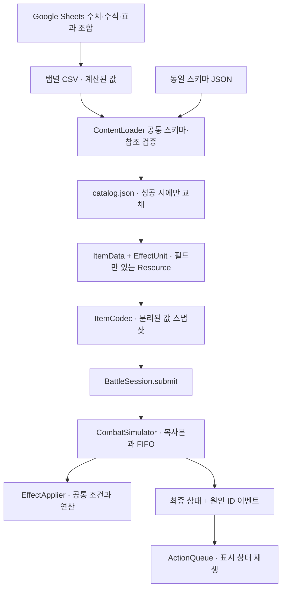

# 콘텐츠 데이터와 실행 엔진

0.4.0부터 아이템 ID·이름·특정 태그를 아는 런타임 분기를 제거했다. 기존 12개 아이템과 적 3종을 데이터로 이관했다. 0.5.0에서는 초기 지급 7개와 전투 보상 2회를 데이터로 구성한다. 수백 개 정의를 등록하는 것과 실제 런에 지급하는 물건 수는 별개다.



## 기획 작업 순서

1. `outputs/data-driven-content/balance-template.xlsx`를 Google Sheets로 가져온다. 이 파일은 로컬에서 수식·값·렌더링을 검증한 가져오기용 템플릿이다. Google 계정에 업로드하거나 원격 문서를 생성하지는 않았다.
2. `effects`의 `_base_amount`와 `Balance`의 연산별 배율을 조정한다. 일반 `amount`는 반올림한 정수 수식 결과다. 밸런스 배율은 아군과 적의 해당 연산 모두에 적용되며, `modify_power`는 `affects` 연산의 배율을 따른다. **`multiply_power`의 amount는 밸런스 배율을 적용하지 않은 정수 배수**다. 필요하면 기획에 맞는 수식으로 교체해도 된다.
3. 아이템의 비용·횟수·형태·태그·효과 참조는 `items`에서 편집한다. 복합 효과는 `effect_ids`에 `a_hit|b_guard|c_heal`처럼 연결한다. 원수치 변경은 같은 효과 단위를 참조하는 모든 아이템에 반영된다. 별도 수치가 필요하면 효과 행을 복사하고 새 ID를 부여한다.
4. `items`, `effects`, `tags`, `loadout`, `encounters`, `rules`, `rewards`, `routes`, `events`, `resolutions`, `hazards` 탭을 각각 CSV로 다운로드해 `content/source/`의 동명 파일로 둔다. 헤더는 첫 행이다. `Balance`는 내보내지 않는다. `art.json`은 시각 자료이며 수치 변경 시 그대로 둔다.
5. 저장소 루트에서 다음을 실행한다.

```bash
bash scripts/import-content.sh
bash scripts/check.sh
bash scripts/run.sh
```

CSV를 검증한 뒤 `game/data/content/catalog.json`을 임시 파일과 rename으로 교체한다. 실패 시 기존 JSON을 덮어쓰지 않는다. 다음 게임 시작/다시 시작에서 읽으며, 진행 중인 전투에 콘텐츠를 끼워 넣지 않는다. 다시 시작도 로드가 실패하면 기존 세션을 유지하고 오류를 표시한다. 0.6.0부터 저장한 런은 카탈로그 전체 해시와 연결되므로 콘텐츠를 바꾸면 기존 저장을 자동으로 혼합하지 않는다. 해당 데이터를 복구하거나 기존 파일을 보관한 뒤 새 런을 시작한다. [저장 호환성](save-system.md)

다른 폴더 또는 같은 스키마의 JSON도 받을 수 있다.

```bash
bash scripts/import-content.sh /absolute/path/downloaded-csv
bash scripts/import-content.sh /absolute/path/catalog.json
bash scripts/import-content.sh content/source --check
```

`--check`는 입력과 현재 게임 JSON의 값이 같은지 확인하고 파일을 쓰지 않는다. 외부 JSON을 직접 반영한 뒤 기본 CSV 가져오기를 다시 실행하면 그 CSV의 내용으로 바뀐다. 협업 시 팀이 선택한 원본을 함께 갱신한다. 게임은 JSON을 기본으로 읽고, 도구와 테스트는 같은 `ContentLoader`의 CSV 진입점을 사용한다.

Google Sheets의 CSV는 수식을 실행하는 파일이 아니다. 결과 값을 다운로드한다. Godot는 수식·스크립트·Callable을 해석하지 않으며 `=...`, `#REF!`, 정수가 아닌 소수값, 범위 밖 수치를 숫자 칸에서 거절한다. 통화/천 단위 구분을 붙이지 않은 정수로 내보낸다. UTF-8 BOM, 한글, 인용된 쉼표·따옴표·줄바꿈은 처리한다. CSV의 `_` 시작 열은 기획용 보조 열로 무시한다. JSON에는 스키마 열만 넣는다.

## 표와 소유권

| 표/파일 | 한 행의 의미 | 주요 필드 |
|---|---|---|
| `items.csv` | 아이템 정의 | `id`, `display_name`, `description`, `footprint`, `tags`, `cost`, `uses_per_turn`, `consumable`, `icon_id`, `effect_ids` |
| `effects.csv` | 재사용 가능한 효과 단위 | 발동 시점·연산·대상·수치·조건·중첩·우선순위 |
| `tags.csv` | 사용할 태그 등록 | `id`, UI용 `label` |
| `loadout.csv` | 런에 지급할 인스턴스 | `id`는 인스턴스 ID, `item_id`는 정의 ID, `x`, `y`, `rotation` |
| `encounters.csv` | 길목의 적 | `order`, `name`, `hp`, 순환 `intent_ids`, `reaction_ids`, `visual_id` |
| `rewards.csv` | 길목별 보상 후보 | `id`, `encounter_id`, `item_ids` (중복 없는 후보 1~3개) |
| `routes.csv` | 갈림길 선택지 | `id`, `name`, `description`, 순서대로 연결한 `encounter_ids`, `reward_ids` |
| `events.csv` | 첫 보상 뒤 유품 사건 | `id`, `step`, 문구·유품 `item_id`·선택 문구·후속 반응·`heal_amount` |
| `resolutions.csv` | 사건 후 별도 결말 설정 (없으면 헤더만) | `id`, `event_id`, `allow_stash`, `message`, `result`, `button`, `unavailable`, `completion_title` |
| `hazards.csv` | 길목별 고정 칸 기력 제약 | `id`, `step`, 절대 `cells`, 대상 `required_tags`, `cost_increase`, 문구 |
| `rules.csv` | 런 기본 규칙 한 행 | 격자 크기, 최대 체력, 턴 기력, 승리 회복, 플레이어 시각 자료 참조 |
| `art.json` | 시각 자료 | 공통 팔레트, 아이콘·캐릭터 사각형 데이터. ID로 참조 |
| `schema.json` | 엔진이 지원하는 계약 | 열·자료형·열거값·범위. 새 동작을 추가할 때 개발자가 변경 |

- 정의 ID는 영문 소문자로 시작하는 `a-z`, `0-9`, `_` 조합, 최대 64자다. 예: `item_ink_blade`. 이름은 자유로운 한국어다.
- 목록은 `|`로 구분하며 빈 문자열은 빈 목록이다. 중복 참조와 미등록 태그를 거절한다.
- `footprint`는 `0:0|0:1|1:1` 형태다. x/y 최소값은 각각 0이어야 하며 중복·음수 칸을 거절한다. 회전은 `GridRules`가 처리한다.
- 보관대는 `x=-1,y=-1`, 회전은 0~3이다. 초기 배치 전체의 경계와 겹침을 검사한다.
- `description`은 분위기·용도 설명이다. 실제 수치와 조건은 효과 데이터에서 UI가 생성한다. 설명에 수치를 다시 적어 두지 않는 편이 좋다.
- 아이템은 `ItemData(Resource)`의 효과 배열을 가진다. `ItemData`와 `EffectUnit`에는 함수·신호가 없다. 회전·태그 조회·스냅샷 변환·시각 재생은 다른 계층의 책임이다.

## 0.10.0 유품 사건 스키마

`schema_version=4`부터 `events.csv`가 필수다. 사건이 없는 카탈로그는 `events: []`, CSV는 헤더만 둔다. 갱신된 템플릿은 Balance와 데이터 9개 탭이며 `events`의 유품·문구·회복량은 다른 탭처럼 CSV로 내보낸다. 현재 엔진은 경로가 있고 세 길목 이상인 런에서 첫 길목 보상 뒤 사건 하나만 지원한다. `item_id`는 기존 비소모 아이템이며 빈 보따리에 놓을 수 있어야 한다. 유품을 두 번째 길목까지 가져온 경우 `heal_amount`만큼 최대 체력을 넘지 않게 회복하고, 두고 가거나 보관대에 둔 경우 다른 문구가 나온다. 내용과 테스트는 [유품 사건](event-flow.md)을 따른다.

0.9 콘텐츠와 일치하는 옛 저장은 사건 데이터를 제거한 카탈로그 해시를 확인한 뒤 이전한다. 이미 사건 위치를 지난 저장은 진행을 되돌리지 않는다. 텍스트·회복량 등 사건 데이터를 바꾸면 일반 콘텐츠 해시가 달라지므로 해당 콘텐츠를 복구하거나 기존 저장을 보관해야 한다.

## 0.7.0 경로 스키마 (이전 버전)

`schema_version=3`에서는 `routes.csv`가 필수다. 분기를 사용하지 않는 기존 테스트 데이터는 `routes: []` 또는 헤더만 있는 CSV를 둔다. 갱신된 템플릿은 Balance와 데이터 8개 탭이다. 각 행의 `encounter_ids`는 같은 첫 길목으로 시작해 모든 적을 중복 없이 한 번씩 나열하고, `reward_ids`는 마지막을 제외한 각 단계의 보상 ID를 순서대로 연결한다. 현재는 두 경로를 제공하고 적 순서만 다르게 한다. 첫 길목의 보상은 공통이어야 하며 두 경로가 같은 순서일 수 없다. 경로 사용 시 `rewards.encounter_id`는 기존 데이터 검증 및 선형 콘텐츠용 참조이며 실제 지급은 경로의 단계별 `reward_ids`를 따른다.

시각 아틀스의 좌표는 게임 콘텐츠와 별도인 `game/data/presentation/retro-art.json`에 둔다. 시트의 `icon_id`와 `visual_id`가 시각 ID에 매칭되며, 아틀스에 없는 ID는 기존 `art.json` 도형으로 표시된다. 아트 교체가 전투 수치나 저장의 콘텐츠 해시를 바꾸지 않는다. 자세한 내용은 [경로 흐름](route-flow.md)과 [아트 참고](art-reference.md)를 참조한다.

## 0.5.0 스키마 변경 (이전 버전)

`schema_version=2`부터 `rewards` 테이블이 필수다. 보상이 없는 카탈로그는 JSON에 `rewards: []`, CSV에는 헤더만 있는 `rewards.csv`를 둔다. 기존 JSON의 버전 숫자만 바꾸지 말고 이 테이블도 추가한다. 기존 Google Sheets 문서를 계속 사용하면 `rewards` 탭을 추가하고 초기 지급을 의도한 `loadout`으로 조정한다. 갱신된 템플릿은 Balance와 데이터 7개 탭, 총 8개 탭이다.

보상 후보는 `rope|sandals|mirror`처럼 아이템 정의 ID로 연결한다. 한 길목에 한 행만 지정하고 마지막 길목은 제외한다. 목록 순서가 카드 순서이며 무작위 추첨은 하지 않는다. 빈 보따리에도 넣을 수 없는 후보는 거절한다. 선택·확정·건너뛰기 계약은 [보상 흐름](reward-flow.md)에 있다.

## 사연 텍스트

첫 인도 사연은 전투 데이터가 아닌 읽기 전용 표시 콘텐츠다. `content/source/story.csv`의 `id,min_completed,title,teaser,text`를 편집하고 `python3 scripts/import-story.py`를 실행하면 검증 후 `game/data/presentation/story.json`을 원자적으로 교체한다. Google Sheets에서 해당 CSV를 내려받아 `python3 scripts/import-story.py /절대경로/story.csv`로 반영할 수 있다. `--check`는 파일을 바꾸지 않고 원본과 게임 JSON의 일치만 확인한다. 기존 밸런스 템플릿의 데이터 탭과 별도이며, 탭을 자동으로 추가하거나 원격 시트와 동기화하지 않는다.

`min_completed`는 완료한 길목 수이며 0은 시작 시 표시한다. 마지막 항목은 인도 완료 후에만 공개된다. 사연 파일 수정은 카탈로그 해시·저장 포맷을 바꾸지 않는다. 판정과 보상은 사연을 읽지 않는다. [사연 데이터와 표시](story-flow.md)

## 효과 단위 계약

| 필드 | 값과 의미 |
|---|---|
| `id` | 효과 단위 ID. 아이템/적이 참조 |
| `trigger` | `use`, `turn_end`, `damage_taken`, `modify` |
| `operation` | `damage`, `guard`, `heal`, `set_guard`, `modify_power`, `multiply_power` |
| `target` | 실행 효과는 `self`, `opponent`; 수정 효과는 `self`, `adjacent_items`, `diagonal_items`, `neighbor_items` |
| `amount` | 일반 효과는 0~100000 정수, `multiply_power`는 1~100000 정수 배수. 2는 2배 |
| `required_tags` | 수정 효과를 받는 물건에 모두 있어야 하는 태그 |
| `condition_tags` | 수치를 계산할 때 세는 인접 물건의 태그. 모두 일치해야 함 |
| `scale` | `flat`, `per_adjacent`, `per_diagonal`, `per_neighbor` |
| `max_matches` | 범위별 물건 수로 수치를 계산할 때 세는 상한. 1~64 |
| `affects` | `modify_power` / `multiply_power`가 수정할 실행 연산. 그 외에는 빈 문자열 |
| `stack_group` | 같은 연산의 같은 그룹에서 하나만 적용. 빈 문자열은 각각 적용 |
| `max_per_action` | 피해 반응이 한 루트 요청에서 발동할 상한. 1~128 |
| `priority` | 작은 숫자부터 처리. -1000~1000 |

범위는 `adjacent_items` / `per_adjacent`가 상하좌우, `diagonal_items` / `per_diagonal`이 대각선, `neighbor_items` / `per_neighbor`가 둘의 합집합이다. 모든 범위는 점유 칸 쌍 중 하나가 조건에 맞으면 충족한다. 다칸 물건이 양쪽 범위에 함께 닿거나 여러 칸이 닿아도 수신·계수 대상 인스턴스당 한 번이며 자기 자신은 제외한다. 회전 후 실제 점유 칸으로 검사하므로 대각선 범위는 별도 방향 설정이 필요 없다.

`target`은 수정 효과를 **받는 물건**의 범위이고, `scale`은 수치를 구하기 위해 **출처 물건 주위에서 세는 물건**의 범위다. 독립적으로 지정할 수 있다. `per_*`의 결과는 `amount × min(조건에 맞는 물건 수, max_matches)`다. `condition_tags`가 비었으면 범위 안의 모든 다른 물건을 센다. 조건 태그를 쓰려면 `per_*`를 지정한다. 예를 들어 `modify,modify_power,diagonal_items,2,...,flat,...,damage`는 대각선 무기의 공격을 +2 하고, `turn_end,guard,self,4,...,per_diagonal`은 대각선 조건 물건마다 방어 4를 준다. `required_tags`와 `affects`는 기존 규칙대로 각각 수신 태그와 수정할 연산을 지정한다.

이번 확장은 기존 필드를 추가하지 않고 스키마 4의 허용 값만 넓혔다. 기존 CSV·카탈로그·저장 해시는 바뀌지 않는다. 새 값을 사용한 콘텐츠는 이전 엔진이 거절할 수 있으므로 업데이트된 엔진과 함께 배포해야 한다. 새 값을 콘텐츠에 실제 반영하면 기존과 마찬가지로 콘텐츠 해시가 달라진다. 템플릿의 `effects` 탭 `target`·`scale` 드롭다운에도 새 값을 추가했다. Google Sheets에서 가져오기·재계산은 별도 확인이 필요하다.

수정 효과는 수신 물건의 해당 연산에 적용한다. 발동 시점과 무관하게 같은 연산에 적용되므로 피해 반응의 `damage`도 조건을 만족하면 수정된다. 영구 능력치를 바꾸지 않는다. 그룹이 같으면 우선순위 → 출처 인스턴스 ID → 효과 ID 순서에서 처음 유효한 하나가 이긴다. 자동으로 가장 큰 수치를 고르지는 않는다. 각 실행 효과마다 별도로 계산한다.

`multiply_power`는 `trigger=modify`, `scale=flat`, `condition_tags` 공란, `amount=1` 이상을 사용한다. `target`과 `required_tags`로 적용 대상을 지정하고 `affects`로 공격·방어·회복·방어 설정 중 하나를 고른다. 각 효과 수치는 **기본값 + 적용되는 고정 증가 전부 → 배율을 우선순위·출처·효과 ID 순서로 각각 곱하기** 순서다. 정수 곱셈이므로 반올림은 없다. 같은 비어 있지 않은 그룹이라도 덧셈과 곱셈은 각각 하나씩 선택하며, 서로 다른 곱셈 그룹과 빈 그룹은 곱연산으로 중첩한다. 예를 들어 기본 공격 6, 고정 +2, 배율 2는 `(6 + 2) × 2 = 16`이다.

계산 결과와 저장 가능한 방어 수치의 정확한 정수 상한은 `9,007,199,254,740,991`이다. 초과 가능성을 곱하기 전에 검사하고, 해당 효과가 실제로 실행돼야 한다면 비용·피해·이벤트를 포함한 요청 전체를 거절한다. 표시에서는 숫자 대신 오류를 보여 준다. 이는 JSON 저장에서 정확히 보존할 수 있는 범위에 대한 안전 경계이며 강한 빌드의 밸런스 제한을 뜻하지 않는다. 죽은 대상에게 적용되지 않는 반응은 기존 규칙대로 건너뛴다. 분수 배율과 조건 수에 따른 배율 변화는 아직 지원하지 않는다.

기존 스키마 4의 열과 출시 카탈로그는 바꾸지 않고 허용 연산만 확장했다. 이전 런의 콘텐츠 해시는 유지되며, 새 배율을 실제 콘텐츠에 넣으면 기존 콘텐츠 불일치 정책이 적용된다. 새 연산은 이전 엔진에서 거절될 수 있으므로 새 콘텐츠와 함께 엔진을 배포한다. [배율 실험](multiplier-experiment.md)

적 의도는 `use`/`flat`, 적 반응은 `damage_taken`/`flat` 단위를 참조한다. 적에게 보따리 인접 규칙을 적용하지 않는다. 여러 `intent_ids`는 턴마다 순환하는 의도 순서다.

### 기존 콘텐츠를 표현하는 예

| 물건 | 조합 |
|---|---|
| 사인검 | `use + damage + opponent + 6`, 기력 1 |
| 봉인부 | `modify + modify_power + adjacent_items + 2`, 수신 태그 `weapon`, `affects=damage`, 중첩 그룹 지정 |
| 혼백등 | `turn_end + guard + self + 4`, 인접 `keepsake` 수만큼, 최대 2 |
| 작은 동경 | `use + guard + self + 4`와 `modify + modify_power + self + 2`, 인접 `lantern` 최대 1, `affects=guard` |
| 작은 약과 | `use + heal + self + 7`, 기력 0, `consumable=true` |

새 “공격 후 방어하는 도구”는 아이템 한 행에 `damage`와 `guard` 단위 두 개를 연결하면 된다. 비용은 사용 요청당 한 번 지불하며, 턴당 횟수는 `uses_per_turn`으로 제한한다. 사용 가능한 연산과 조건 안에서는 조합·수치·태그만 바꾸면 된다. 독의 지속 시간, 이동, 소환 등 **새 연산 자체**는 스키마·엔진·테스트 확장이 필요하다.

## 판정과 재생

`EffectApplier.plan()`이 조건·수치·수정 원인을 값으로 만들고, `evaluate()`가 상태 변경분을 반환한다. `CombatSimulator`가 자신의 복사본에만 적용하며 FIFO·원인 ID·승패를 소유한다. UI도 같은 계획 함수를 사용해 결과를 표시하므로 별도의 아이템별 계산이 없다.

계획의 조건 일치 물건·범위와 실제 선택된 수정 출처는 [시너지 연결 표시](synergy-visualization.md)에도 사용된다. `max_matches`보다 많은 조건 일치는 상한을 명시하고 모두 표시하며 계산 수치를 중복 증가시키지 않는다. 조건의 표시만으로 피해 반응 등이 반드시 발동한다고 가정하지 않는다.

같은 루트 안의 여러 효과는 우선순위와 효과 ID로 정렬해 큐에 넣는다. 반응은 현재 대기열 뒤에 붙는다. 예를 들어 사용 효과가 공격+방어라면 공격에서 나온 반사가 기존 대기 중인 방어 뒤에 재생될 수 있다. 콘텐츠 행 순서는 우선순위가 아니다.

장비 피해 반응은 현재 **보따리에 있는 인스턴스**에서 수집한다. 보관대는 제외한다. 소비는 연쇄가 끝난 뒤 실행하므로 소모품은 자신의 마지막 행동 안에서 반응할 수 있고, 다음 요청에서는 제거된다. 같은 효과 Resource를 두 인스턴스가 공유해도 반응 카운터는 인스턴스별이다. 치명타 반응·양쪽 사망·죽은 대상의 후속 효과 규칙은 [전투 아키텍처](combat-architecture.md)를 따른다.

게임의 유일한 전투 명령 진입점은 여전히 `BattleSession.submit()`이다. 성공한 판정만 한 번 커밋하고 Action Queue는 이벤트의 표시 스냅샷을 재생한다.

## 오류와 검증

- CSV/JSON은 동일 스키마로 검사한다. 중복 ID/헤더, 모르는 필드/연산, 잘못된 타입·수식 결과, 깨진 참조, 중복 점유, 잘못된 시각 자료를 거절한다.
- 파일당 16MiB, 테이블당 10000행, 아이템당 효과 32개를 입력 상한으로 둔다. 현재 격자는 최대 64칸, 동시에 장착된 효과는 최대 256개이며 과도한 조합은 효과 계획을 계산하기 전에 거절한다. 카탈로그의 수천 개 정의와 현재 장착 수의 상한은 별개다. 런타임 연쇄는 기존 효과·이벤트 128개, 깊이 32 상한을 유지한다.
- 제작 표의 수식과 참조 범위는 2000행까지 준비했다. 새 효과는 기존 행을 복사하여 `amount` 수식을 함께 가져오고, Balance 비교 표에 새 ID 행을 복사해 추가한다. 더 늘릴 경우 수식 참조·검증 범위를 함께 확장한다.
- `content_tests.gd`는 출시 JSON 로드, CSV→JSON 값 보존, 이름/태그 전면 교체, 복합 효과, 비용·사용 횟수, 장착/보관/소모 반응, 입력 거절과 추가 500개 정의를 검증한다. 추가 정의는 테스트에만 존재한다.
- 기존 99개 규칙·22개 연쇄·24개 재생 및 UI 검사는 `tests/fixtures/baseline.json`의 고정 수치를 사용한다. 기획자가 출시 수치를 바꿨다고 과거 회귀 테스트의 기대값을 함께 바꿀 필요가 없다. 픽스처는 스키마 이전과 명시적 규칙 변경 때만 검토한다.
- 기본 배율에서 템플릿의 CSV 계산 결과를 실제 Godot 로더로 검사했다. Google Sheets 계정의 업로드·권한·네이티브 재계산은 별도로 수행하지 않았다.

## 공식 참고

[Godot FileAccess](https://docs.godotengine.org/en/stable/classes/class_fileaccess.html): CSV 읽기와 export 시 원본 파일 포함 조건. JSON·스키마는 `export_presets.cfg`의 `*.json` 필터로 포함한다.

[Google 문서 데이터 내보내기](https://support.google.com/docs/answer/9759608?hl=en): 작업한 문서 데이터를 다운로드하는 경로. 이 프로젝트는 계정 API나 실행 중 네트워크 동기화에 의존하지 않는다.


## 사건 기반 결말 데이터

`resolutions.csv`는 헤더가 필수이며, 기능을 사용하지 않으면 행을 비운다. JSON에서는 필드를 생략하거나 빈 배열로 둘 수 있다. 빈 표는 정규화 과정에서 제거하므로 기존 카탈로그 해시는 유지된다. 행이 있으면 단 하나의 사건을 `event_id`로 참조하고, 보관대 확정 허용 여부와 버튼·결말 문구를 지정한다. 결말은 사건 직후 길목에서만 가능하며, 사건 아이템을 보따리에 휴대한 상태에서 선택한다. 선택한 경로와 무관하게 그 대면 이후 스테이지가 끝나므로 다음 보상은 지급하지 않는다. 다중 사건·여러 결말·다른 위치나 추가 조건은 아직 지원하지 않는다.

`resolutions`에 값이 생기거나 바뀌면 콘텐츠 해시가 바뀐다. 기존 저장과 데이터를 자동으로 혼합하지 않는다. Google Sheets 템플릿의 동명 탭은 현재 아랑 스테이지의 결말 행을 포함하며 다른 탭과 마찬가지로 CSV로 내려받는다. [아랑전설 1스테이지](arang-stage-one.md)가 이 구조를 사용한다.


## 길목별 칸 제약

`hazards.csv`는 헤더 필수이고 행이 없으면 기능이 꺼진다. JSON은 필드 생략 또는 빈 배열도 허용하며, 이 둘은 같은 값으로 정규화해 기존 콘텐츠 해시를 유지한다. 한기 데이터와 기력 판정은 [원혼의 한기](frost-grid.md)를 참고한다. 현재 본편에는 아랑 대면 전 위쪽 다섯 칸에 대상 태그 `weapon`과 기력 +1을 적용하는 행이 있다.


0.16.0 본편 예시: 옥가락지의 `jade_diagonal_factor`는 대각선 무기 공격에 2배를 적용하며 연못 경로 아랑의 `arang_pain_reaction`은 체력 피해에 공격 2로 반응한다. 두 효과와 적 체력·경로 설명은 CSV와 밸런싱 템플릿에서 관리한다. 기존 아이템·적 정의의 수는 바꾸지 않았다.


야광귀 전투의 시험 설정은 [별도 시제품](yagwang-experiment.md)으로 격리했다. `yagwang-rules.json`은 출시용 CSV/JSON 스키마에 포함되지 않으며 Google Sheets 배포용 규칙이 아니다. 본편에 도입할 때 새로운 범용 연산·저장 상태와 함께 데이터 계약을 설계한다.


`art.json`의 아이콘 또는 인물 정의는 선택적으로 `texture_path`를, 인물 정의는 추가로 `background_path`를 지정할 수 있다. 경로는 실제 존재하는 `res://assets/visuals/` 아래 PNG만 허용하며 `..`는 거절한다. 경로가 없는 기존 정의는 기존 아틀스 또는 사각형 표현을 그대로 사용한다. 시제품은 별도 카탈로그에서 이 경로를 참조하며, 시제품 전용 그림은 현재 출시 패키지에서 제외한다. 아이템 효과와 전투 규칙은 경로를 해석하지 않는다.
