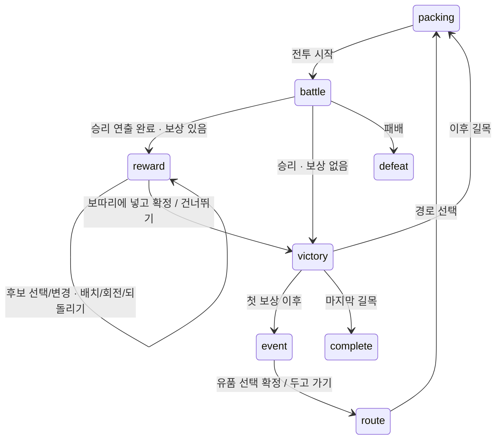

# 0.5.0 전투 보상과 재배치

첫 두 전투에서 보상 후보 세 개 중 하나를 선택해 보따리에 넣고 확정한다. 기존 12종·적 3종을 유지하며 초기 지급만 7개로 조정했다. 시작 물건은 검·봉인부·혼백등·옥가락지·갓·방울·약과다. 첫 보상은 오라/짚신/동경, 두 번째는 적패지/엽전/약과다. 후보는 데이터에 정한 순서대로 표시하며 난수·재추첨은 없다. 0.6.0부터 보상 선택·배치·확정은 [저장 시스템](save-system.md)으로 복구한다.

## 플레이 계약

- 후보를 클릭하면 `reward/<offer_id>`라는 별도 인스턴스가 보관대에 생기고 바로 선택된다. 드래그하거나 빈칸을 클릭해 보따리에 넣는다. 같은 정의의 기존 물건과 인스턴스 ID·사용 횟수를 공유하지 않는다.
- 보따리 안에 정상 배치해야 확정할 수 있다. 겹침·경계·효과 수 제한은 기존 인벤토리 규칙이 처리한다. 회전·배치 취소·되돌리기를 사용할 수 있다.
- 다른 후보를 선택하면 시험 중인 보상만 제거하고 새 후보를 보관대에 놓는다. 이미 옮긴 기존 장비는 그대로 둔다. 같은 후보를 다시 눌러도 배치를 초기화하지 않는다.
- 후보 변경·확정·건너뛰기에서 배치 이력을 비운다. 이전 이력으로 미획득 보상을 되살리거나 확정된 보상을 이전 후보로 바꿀 수 없다.
- 건너뛰기는 시험 중인 보상을 제거한다. 기존 장비의 재배치는 유지한다. 보상은 다시 열리지 않는다.
- 확정은 시험 배치한 인스턴스 자체를 획득 상태로 바꾼다. 별도 아이템을 추가 생성하지 않는다. 확정·건너뛰기 후에만 다음 길목으로 이동한다.
- 마지막 길목에는 보상을 제공하지 않는다. 현재 보관대는 기존 물건을 계속 보유하는 공간이며 판매·폐기·용량 제한은 별도 기능이다.

## 데이터와 상태 소유권

`rewards.csv`의 `id`, `encounter_id`, `item_ids`로 보상을 정의한다. 한 길목당 한 행, 중복 없는 후보 1~3개다. 경로가 있는 경우 지급 순서는 `routes.reward_ids`가 정한다. 없는 아이템/길목, 마지막 길목 보상, 빈 보따리에도 어느 방향으로든 들어가지 않는 후보는 로드 시 거절한다. 특정 아이템을 아는 런타임 분기는 없다.

`CombatSimulator`는 연쇄·사망을 모두 판정한 뒤 승리할 때만 `RewardRules.open()`으로 복사본에 제안을 붙인다. 동시 사망은 보상을 열지 않는다. 제안은 승리 이벤트의 스냅샷에 들어가므로 화면에 미리 노출되지 않는다.

`RewardRules`는 값 데이터만 다룬다. `reward_select`, `reward_confirm`, `reward_skip` 요청은 모두 **BattleSession.submit → CombatResolver → RewardRules**로 전달하고 같은 `CombatResolution` 계약으로 원자적 커밋·Action Queue 재생을 거친다. 전투 명령은 계속 `CombatSimulator`가 담당한다. UI나 보상 카드가 아이템을 직접 지급하지 않는다.

상태의 `reward`는 `offer_id`, `candidates`, `selected`, `uid`, `status`를 가진다. `status`는 `pending / claimed / skipped`다. 현재 단계와 제안 ID를 확인해 전투 중 요청, 이미 처리한 제안, 이전 길목의 요청을 거절한다. 다음 길목에서는 제안을 비운다.

후보 선택도 확정 상태와 표시 상태를 함께 전환한다. 선택·확정 연출 중에는 입력과 배치가 잠긴다. 건너뛰기·재시작·지연된 연출 콜백은 기존 큐의 취소·세대 번호 보호를 따른다. 연출이 보상을 다시 생성하거나 판정하지 않는다.

## 검증

- 미승리·이전 제안·후보 외 ID·미배치 확정·중복 확정·늦은 건너뛰기 거절.
- 시험 배치·회전·되돌리기·후보 교체, 기존 배치 보존, 이력으로 보상 복구 차단.
- 같은 정의의 별도 인스턴스, 다음 전투에서 정상 효과 실행, 마지막 전투·동시 사망 처리.
- 승리 이전 화면 노출 차단, 연속 클릭 잠금, 스킵·재시작과 늦은 콜백.
- 초기 7개 → 전투 3회 → 보상 확정 2회의 자동 완주. 고정 밸런스 픽스처를 사용한다.
- 1024×576/1280×720/1920×1080 보상 카드·설명·확정·건너뛰기 경계와 인스턴스 ID를 사용하는 보관대 드래그.

최종 아트와 M2 외부 관찰은 이번 기능 완료와 별개다. 자동 완주는 보상 선택의 재미나 출시 밸런스를 입증하지 않는다.
